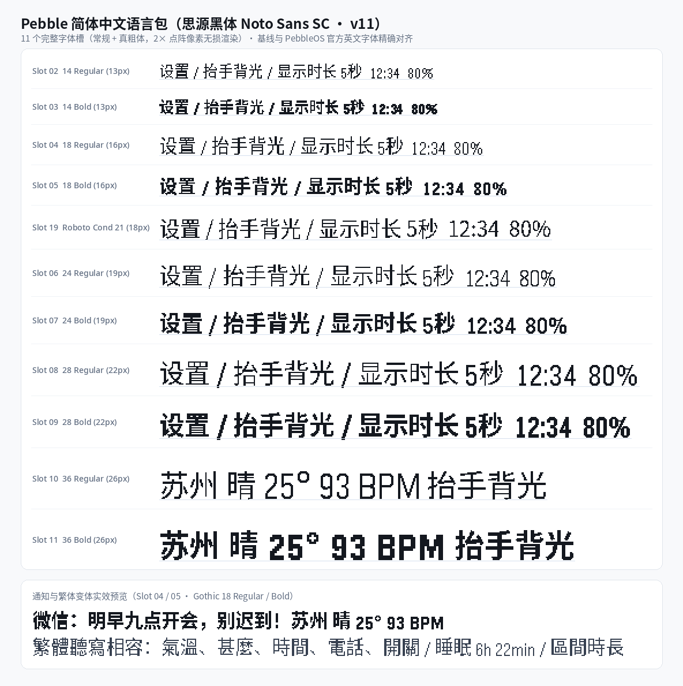

# Pebble 简体中文语言包（思源黑体）

专为 Pebble Time 2 打造的简体中文语言包，解决官方语言包宋体字形裁顶、社区包字号偏小且无真粗体的问题。

当前版本：**v8**，请到 [Releases](../../releases) 下载 `pebble-zh-CN-notosans-v8.pbl`。

## 字体

- 思源黑体（Noto Sans SC），8 个字体槽：常规 / 真粗体 × 4 档字高（13 / 16 / 19 / 22）
- 每槽 10,398 个字形：GB2312 全部汉字 + Big5 常用繁体字，语音听写出现繁体变体字（如「氣」「麼」）也不再显示豆腐块
- 字形基线按 PebbleOS v4.19.1+ 英文字体对齐，不裁顶、不漂移，与拉丁字母同基线齐平

## 翻译

- 对照固件官方字符串表核查：625 / 625 全覆盖，另含 260 条面向新固件的词条，共 886 条
- 称呼统一用「您」；细节经多轮校对（如通知 Timeout 译为「通知停留时间」、心率单位「次/分」），无空条目、无格式符错误

## 验证

- 打包 CRC 全部通过；按固件的查表算法离线模拟，886 / 886 条全部命中
- 已在 Pebble Time 2 真机验证显示正常

## 安装

1. 下载 `pebble-zh-CN-notosans-v8.pbl`（约 4.0 MB）
2. 用 Pebble 手机 App 打开该文件即可安装；如装过其他中文包，先在 App 里删掉旧包再装
3. 安装后在语言设置里选择「简体中文」

注：第三方表盘 / 应用自身的文字、手机推送的通知正文不在系统语言包范围内，任何语言包都覆盖不到。

## 许可

- 字体 Noto Sans SC © Google，遵循 SIL Open Font License 1.1
- 翻译与打包：MIT
